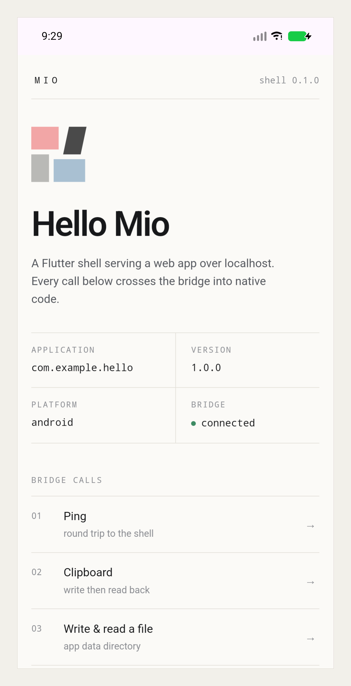
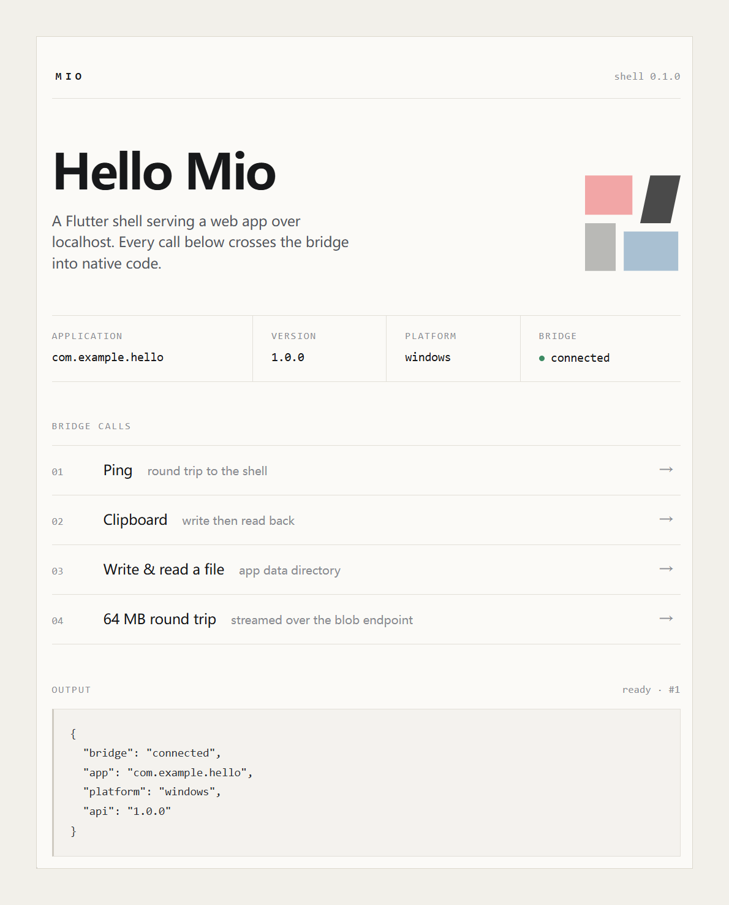

# Mio


把 Web 应用打包成 Android APK 和 Windows 桌面应用。

壳是一个预编译的 Flutter 应用，业务代码是网页。CLI 把网页打成一个归档塞进壳里，
再补上图标、包名、版本和签名 —— 全程不编译 Flutter。

| Android | Windows |
| --- | --- |
|  |  |

同一个页面在两端：`@iyexin/mio-cli` 生成的示例应用，四条桥调用。

> **NOTE**
> Mio 面向 Web 优先、原生需求很浅的小应用：一个 WebView、一层 JSON 桥、按需加载自己的
> 原生库。不适合需要完整 Android SDK 或原生 UI（相机预览、地图、复杂后台服务）、依赖插件
> 生态与第三方扩展、要求商店合规与安全审计、或需要长期 API 兼容承诺的项目 —— 这些场景直接
> 用原生、Flutter 或 Tauri/Electron 更省事。

## 快速开始

```bash
npx @iyexin/mio-cli create my-app
cd my-app
npm install
npx @iyexin/mio-cli dev --platform windows   # 改代码即时生效
npx @iyexin/mio-cli build --platform android # 产出 APK
```

也可以全局安装：

```bash
npm install -g @iyexin/mio-cli
mio create my-app
```

`create` 生成的项目是一个普通 Vite + TypeScript 应用，只有一个依赖
`@iyexin/mio-api`。构建产物在 `build/mio/`：

```text
build/mio/android/My-App-1.0.0.apk
build/mio/windows/My-App/
```

## 工作方式

```text
网页（Vite） ──npm run build──▶ dist/
                                  │
                                  ▼
                       app.asar（含 mio-manifest.json）
                                  │
                    ┌─────────────┴─────────────┐
                    ▼                           ▼
              APK：注入 assets/mio/app.asar   exe：写入 PE 资源 MIO_ASAR
              zipalign → 签名 → 校验
```

启动时，壳读取归档，用本地 HTTP 提供静态文件，把页面挂到 WebView 里，再注入
`window.Mio`。页面调用经 WebSocket（JSON-RPC 2.0）到壳，壳再落到平台 API。
桥每一轮启动生成一次性 token，只监听 `127.0.0.1`。

## 能力

| 命名空间 | 内容 |
| --- | --- |
| `Mio.app` | 应用元信息、路径、日志、退出 |
| `Mio.platform` | 平台、架构、能力表、常亮、屏幕方向 |
| `Mio.fs` | 可写目录内的文件读写 |
| `Mio.dialog` | 系统文件选择器 |
| `Mio.clipboard` | 剪贴板 |
| `Mio.shell` | 打开文件/目录 |
| `Mio.windowApi` | 窗口大小、位置、最大化、全屏 |
| `Mio.nativeApi` | 加载原生库、标量调用、事件回调 |
| `Mio.processApi` | 拉起子进程、管道、结束进程（Windows） |
| `Mio.http` | 不受 CORS 限制的请求、下载、本地 HTTP 服务 |
| `Mio.notify` | 系统通知（Android） |
| `Mio.media` | 相册/图片选择 |
| `Mio.foreground` | Android 前台服务（需在配置里声明） |
| `Mio.tray` | Windows 托盘图标与菜单 |
| `Mio.share` | 系统分享（文本 / 文件） |

所有调用都是 Promise，错误是 `MioError`（`code` 为符号，`rpcCode` 为 JSON-RPC 数字）。
完整签名、事件和错误码见 [docs/api.md](docs/api.md)。

除了请求，桥还会推事件：`bridge.state`（连接状态）和原生库的 `nativeApi` 事件。
心跳每 5 秒一次，4 秒没响应就重连，页面可以据此显示离线状态。

二进制传输走 HTTP：`Mio.fs` 之外的大文件用 blob 端点上传/下载，支持 Range，
上传是写 `.part` 再原子重命名。

## 原生能力

应用可以带自己的 `.so` / `.dll`，壳按需加载：

```js
const lib = await Mio.nativeApi.load("demo");
await Mio.nativeApi.call(lib, "mio_add", [2, 3]); // 5
await Mio.nativeApi.start(lib, { tick: 250 }, (event, payload) => {
  console.log(event, payload);
});
```

支持的调用签名是固定的一组标量组合（`i32` / `f64` / `str` / `void`），
入口是 `mio_start(sink, config)` 和 `mio_event`。原生库跑在独立 isolate 里，
主线程和桥不受阻塞。示例和编译脚本在 [examples/native-demo](examples/native-demo/README.md)。

## 模板

预编译模板作为 GitHub Release 资产分发，`build` / `dev` 首次使用时按 ABI 下载
（arm64 约 19 MB，universal 约 54 MB，x64 约 20 MB；Windows 约 12 MB），
校验 sha256 后缓存到 `%LOCALAPPDATA%\mio\templates\<版本>\`。下载使用
`HTTPS_PROXY` / `HTTP_PROXY`，没有设置时回退到 `git config http.proxy`。

自建模板：

```bash
./scripts/build-templates.ps1            # 需要 Flutter、Android SDK、Visual Studio
npx @iyexin/mio-cli build --template ./my-template.apk
```

## 配置

`mio.config.json`：

```json
{
  "app": { "id": "dev.example.notes", "name": "Notes", "version": "1.0.0", "icon": "icon.png" },
  "window": {
    "width": 1100, "height": 780, "title": "Notes",
    "minWidth": 720, "minHeight": 480, "center": true,
    "decorations": true, "resizable": true, "alwaysOnTop": false
  },
  "web": { "outDir": "dist" },
  "android": { "abi": "arm64", "minSdk": 24, "keystore": "release.p12", "storePasswordEnv": "MIO_KS_PASS" },
  "windows": { "signCommand": "signtool sign /fd sha256 /f cert.pfx {exe}" }
}
```

签名只有一条规则：密码走环境变量（`storePasswordEnv` / `keyPasswordEnv`），
不落命令行、不进配置文件。细节见 [docs/signing.md](docs/signing.md)。

## 仓库结构

```text
packages/cli/            CLI（create / build / dev / doctor）+ 脚手架模板
packages/api/            页面侧的 TypeScript API（@iyexin/mio-api）
packages/android-tools/  APK 注入、zipalign、apksigner、PE 资源编辑
shell/                   Flutter 壳（Android + Windows）
templates/web/           脚手架源
examples/native-demo/    原生库示例
tools/verification/      手工验证应用（原生 API / 进程 API）
```

改壳之后要重建模板，见 [docs/template-maintenance.md](docs/template-maintenance.md)。
架构与传输细节见 [docs/architecture.md](docs/architecture.md)。

## 文档

- [API v1](docs/api.md)
- [架构](docs/architecture.md)
- [原生能力](docs/native-extensions.md)
- [签名](docs/signing.md)
- [模板维护](docs/template-maintenance.md)
- [发布流程](docs/release.md)
- [文档索引](docs/README.md)

## 开发

```bash
pnpm install
pnpm -r build
pnpm -r test          # Node 侧：CLI、android-tools、脚手架
cd shell && flutter analyze && flutter test
```

发布检查：

```bash
pwsh ./scripts/verify-release.ps1        # 版本、文档覆盖、模板策略
pwsh ./scripts/verify-release.ps1 -Full  # 加上构建、类型检查、测试
```

## 许可证

MIT，见 [LICENSE](LICENSE)。
